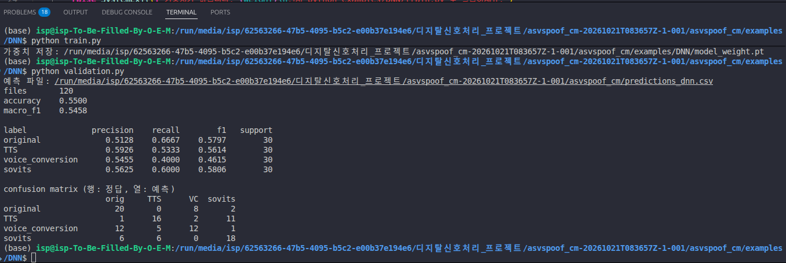

# Real vs Synthetic Speech Classification

음성 파일을 듣고, **사람이 실제로 녹음한 목소리**인지 **프로그램이 만든 목소리**인지 맞히는 과제입니다.

모델을 새로 만들어도 되고, 이미 있는 머신러닝이나 딥러닝 코드를 고쳐 써도 됩니다. 사용 언어와 라이브러리는 자유입니다. 마지막에 내는 파일 형식만 아래와 같으면 됩니다.

## 맞혀야 하는 것

정답은 네 가지 중 하나입니다. 철자가 다르면 오답입니다.

| 적을 말              | 뜻                                              |
| -------------------- | ----------------------------------------------- |
| `original`         | 사람이 실제로 녹음한 목소리                     |
| `TTS`              | 글자를 음성으로 읽어 만든 목소리                |
| `voice_conversion` | 다른 사람 목소리를 이 화자처럼 바꿔 만든 목소리 |
| `sovits`           | 해당 화자 목소리로 짧게 학습한 뒤 만든 목소리   |

 |

`speaker_id`는 누구의 목소리인지만 알려 줍니다. 정답이 아닙니다. 같은 사람의 실제 녹음과 만든 목소리가 함께 들어 있습니다. 문장 내용은 파일마다 다릅니다. 문장이 아니라 **목소리가 어떻게 만들어졌는지**를 맞히면 됩니다.

## 파일 목록

```text
requirements.txt         필요한 라이브러리와 버전
dataset/
  train.csv              학습용 목록. 정답이 적혀 있습니다.
  valid.csv              검증용 목록. 정답이 적혀 있습니다.
  audio/                 위 목록의 음성 파일
examples/
  common.py              목록 읽기, 예측 CSV 쓰기, 점수 계산 유틸을 모아놓은 파일
  DNN/
    models.py            입력 만들기(로그 스펙트로그램)와 모델 구조
    train.py             학습 → model_weight.pt 저장
    validation.py        model_weight.pt 로 valid 점수 확인 (제출하면 predict.py)
  Rule-based/
    features.py          멜 에너지와 청각 특징 33개 
    rules/ifelse.py      사람이 짠 if / elif / else 규칙
    randomforest.py      랜덤 포레스트 학습 → randomforest.joblib 저장
    validation.py        METHOD 로 고른 분류기로 valid 점수 확인 (제출하면 predict.py)
```

테스트 음성은 이 저장소에 없습니다. 조교가 가지고 있으며, 여러분이 낸 코드를 조교가 테스트 음성에 돌려 채점합니다.

| 파일  | 화자 수 | 정답               |
| ----- | ------- | ------------------ |
| train | 10명    | 있음               |
| valid | 10명    | 있음               |
| test  | 20명    | 조교만 가지고 있음 |

학습, 검증 모두 화자 10명, 라벨 4개가 각각 30개씩 들어 있습니다.

## 환경 준비

어느 컴퓨터든 아래 순서대로 하면 실행가능한 환경이 됩니다. Python 3.10 ~ 3.13 (권장 3.12)이 필요합니다.

```bash
python -m venv .venv
# Windows:      .venv\Scripts\activate
# macOS/Linux:  source .venv/bin/activate
pip install -r requirements.txt
```

`requirements.txt`의 버전을 바꾸지 마세요. 버전이 다르면 저장한 가중치(`.joblib`, `.pt`)가 조교 컴퓨터에서 안 열릴 수 있습니다. 다른 라이브러리가 꼭 필요하면 조교에게 먼저 물어보세요.

## CSV 읽는 법

엑셀, 메모장, 파이썬 모두 가능합니다. 엑셀에서 한글이 깨지면 데이터 탭의 텍스트/CSV에서 원본 파일을 **UTF-8**로 여세요.

`train.csv`와 `valid.csv`의 열은 같습니다.

| 열 이름           | 예시                   | 설명                                     |
| ----------------- | ---------------------- | ---------------------------------------- |
| `path`          | `audio/tr_0001.flac` | `dataset` 폴더 안에서 음성 파일의 위치 |
| `label`         | `TTS`                | 정답                                     |
| `speaker_id`    | `LA_0079`            | 화자 번호                                |
| `sampling_rate` | `16000`              | 1초에 16000번 샘플링된 소리              |
| `duration_sec`  | `5.890`              | 길이(초)                                 |

음성은 모두 16 kHz, 모노, FLAC입니다. 길이는 파일마다 다릅니다.

파이썬으로 첫 줄을 확인하는 예입니다.

```python
import pandas as pd

train = pd.read_csv("dataset/train.csv")
print(train.head())
print(train["label"].value_counts())
```

`pandas`는 위 환경 준비에서 함께 설치됩니다.

음성 하나를 들으려면 `dataset/audio/tr_0001.flac`를 그대로 재생하면 됩니다.

## 학습과 검증

- **train**: 모델을 만들 때 사용합니다.
- **valid**: 만든 모델이 새 음성에도 맞는지 확인할 때 사용합니다. 여기 점수를 보고 모델을 고칩니다.
- **test**: 조교가 여러분의 코드로 한 번만 돌립니다. 여러분은 볼 수 없습니다.

검증에서 잘 맞았다고 테스트에서도 같지는 않습니다. 검증 점수는 내 점검용입니다.

## 예시 예측 코드

### DNN (딥러닝)

로그 스펙트로그램을 작은 1D CNN에 넣습니다.

```bash
python examples/DNN/train.py         # examples/DNN/model_weight.pt 저장
python examples/DNN/validation.py    # valid 점수
```

모델을 바꾸려면 `models.py`의 `SmallCNN`을, 학습 설정은 `train.py`의 `EPOCHS`, `LR`을 고칩니다.

### Rule-based (규칙 기반 분류)

`features.py`가 뽑는 특징 33개를 세 가지 방법으로 분류합니다. 같은 특징으로 사람이 규칙을 짜는 것과 기계가 경계를 찾는 것을 비교해 볼 수 있습니다. 특징의 뜻은 `rules/ifelse.py` 맨 위에 적혀 있습니다.

| 방법           | 학습                                                                        | `validation.py`의 `METHOD` |
| -------------- | --------------------------------------------------------------------------- | ------------------------------ |
| if / else 규칙 | 없음. `rules/ifelse.py` 이건 과거 전통적 분류 방식을 이해 하기위한 예시 | `"ifelse"`                   |
| 랜덤 포레스트  | `python examples/Rule-based/randomforest.py` → `randomforest.joblib`   | `"randomforest"`             |

```bash
python examples/Rule-based/svm.py           # 학습
# validation.py 맨 위를 METHOD = "svm" 으로 고친 뒤
python examples/Rule-based/validation.py    # valid 점수
```

터미널에 이렇게 나옵니다.

 

혼동 행렬의 행은 정답, 열은 예측입니다. 대각선이 맞힌 개수이고, 대각선 밖을 보면 어떤 라벨끼리 헷갈리는지 알 수 있습니다.

## 점수

채점 기준은 **macro F1**입니다.

네 라벨을 각각 얼마나 맞혔는지(F1) 본 다음 그 넷의 평균입니다. 한 라벨만 잘 맞히고 나머지는 틀리면 점수가 낮아집니다. 그래서 네 종류를 고루 맞히는 편이 유리합니다. accuracy는 전체 중 몇 개를 맞혔는지입니다. 순위는 accuracy가 아니라 macro F1입니다.

## 제출 규격

내는 것은 **폴더 하나를 묶은 zip**입니다. 폴더에는 실행 파일 `predict.py`와, 그것이 쓰는 코드·가중치 파일이 들어 있어야 합니다.

```text
20231234_홍길동/
  predict.py          반드시 이 이름
  model_weight.pt     학습해 둔 가중치 (있으면)
  models.py ...       predict.py 가 import 하는 내 코드 (있으면)
```

조교는 이 폴더 안에서 아래 한 줄만 실행합니다.

```bash
python predict.py 목록.csv 예측.csv
```

- `목록.csv`: 테스트 목록. 열은 `path,speaker_id,sampling_rate,duration_sec`이고 **label 열은 없습니다.** 음성은 `목록.csv`가 있는 폴더 기준 `path` 위치에 있습니다.
- `예측.csv`: 여기에 결과를 씁니다. 첫 줄은 `filename,pred_label`입니다.

```csv
filename,pred_label
te_0001.flac,original
te_0002.flac,TTS
```

| 열 이름        | 설명                                                                                                          |
| -------------- | ------------------------------------------------------------------------------------------------------------- |
| `filename`   | 음성 파일 이름만. 폴더 경로 없이 `te_0001.flac`                                                             |
| `pred_label` | 맞힌 라벨. `original`, `TTS`, `voice_conversion`, `sovits` 중 하나. 철자와 대소문자까지 같아야 합니다 |

지켜야 할 것:

- `predict.py`는 **학습하지 않고** 저장한 가중치로 예측만 합니다. 학습은 미리 내 컴퓨터에서 끝내고 가중치 파일을 함께 넣으세요.
- 가중치 파일은 `predict.py` 위치 기준으로 찾으세요. 예: `Path(__file__).resolve().parent / "model_weight.pt"`
- 인터넷, `dataset/` 폴더, 다른 경로의 파일에 의존하면 안 됩니다. 필요한 건 전부 폴더 안에 넣으세요.

예시의 `validation.py`는 이 규격을 지킵니다. 인자 두 개를 주면 점수 없이 예측 CSV만 씁니다. 그래서 `validation.py`를 `predict.py`로 이름만 바꿔 내면 됩니다.

```bash
python examples/DNN/validation.py dataset/valid.csv my_pred.csv
```
